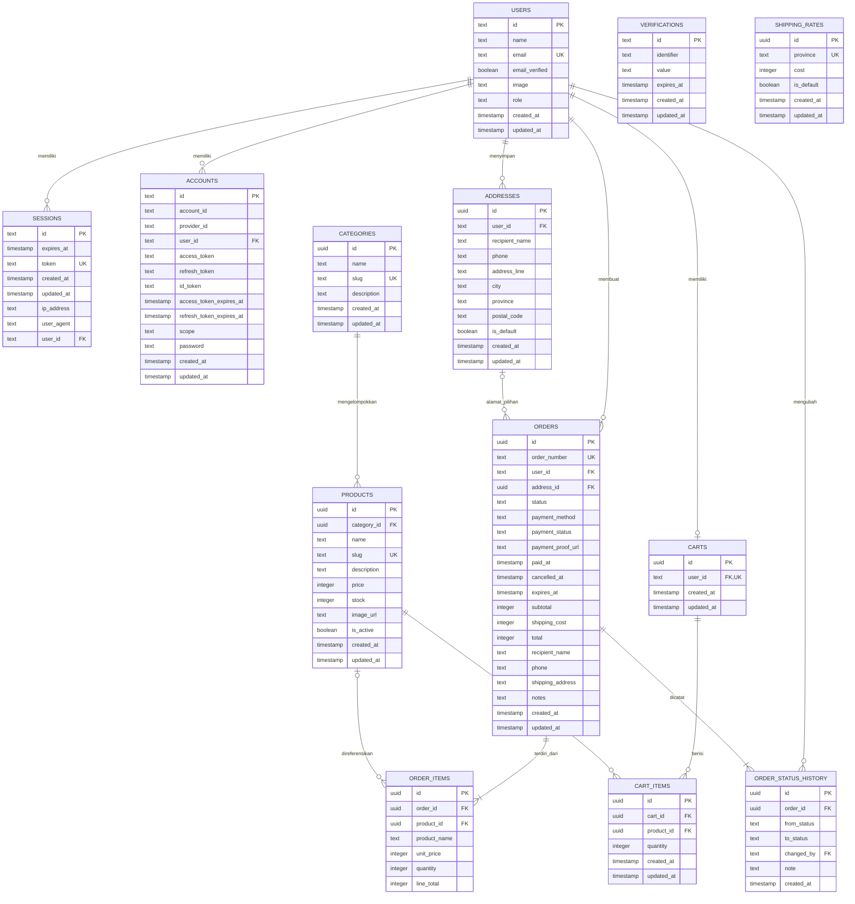

# PRD dan ERD Aplikasi Belanja Online

> [!note] Catatan revisi
> Dokumen ini adalah revisi dari PRD dan ERD awal. Perubahan utama: alur pembayaran manual, aturan stok, ongkir, transisi status pesanan, keranjang tamu, upload gambar, kebutuhan non-fungsional, dan penyempurnaan skema database.

---

# Bagian A. PRD

## 1. Ringkasan Produk

Aplikasi web untuk membantu pelanggan menemukan produk, memasukkannya ke keranjang, dan menyelesaikan pesanan secara online. Desain responsif dengan tema warna cappuccino dan mocha.

## 2. Tujuan dan Metrik Keberhasilan

### Tujuan

- Memudahkan pelanggan mencari dan membeli produk.
- Memberikan pengalaman belanja yang nyaman di desktop maupun mobile.
- Menyediakan fitur dasar bagi admin untuk mengelola katalog, pesanan, dan verifikasi pembayaran.

### Metrik keberhasilan MVP

- Pelanggan dapat menyelesaikan checkout dalam kurang dari 2 menit setelah keranjang terisi.
- Halaman katalog termuat kurang dari 3 detik pada koneksi 4G.
- Skor Lighthouse mobile minimal 80 untuk performa dan aksesibilitas.
- Alur checkout lolos pengujian E2E tanpa error.

## 3. Jenis Pengguna

### Pengunjung

- Melihat dan mencari produk, serta melihat detail produk.
- Menambahkan produk ke keranjang tamu.

### Pelanggan

- Mendaftar, login, logout, dan reset password.
- Mengelola profil, alamat, dan keranjang.
- Membuat pesanan, mengunggah bukti pembayaran, melihat status, dan membatalkan pesanan tertentu.

### Admin

- Mengelola produk, kategori, dan stok.
- Melihat pesanan, memverifikasi pembayaran, dan memperbarui status pesanan.
- Mengatur tarif ongkir.

## 4. Fitur Utama

### 4.1 Autentikasi dan Akun

- Registrasi, login, dan logout menggunakan Better Auth.
- Verifikasi email setelah registrasi.
- Lupa dan reset password melalui email.
- Pelanggan dapat mengelola profil dan alamat pengiriman (satu alamat utama).
- Akses admin dibatasi berdasarkan kolom `role`.
- Akun admin pertama dibuat lewat seed script, bukan lewat registrasi publik.

### 4.2 Katalog Produk

- Beranda menampilkan produk unggulan dan kategori.
- Daftar produk mendukung pencarian, filter kategori, pengurutan, dan pagination.
- Halaman detail menampilkan foto, deskripsi, harga, dan stok.
- Produk dengan `is_active = false` tidak tampil di katalog.
- Produk dengan stok 0 tetap tampil dengan label "Stok habis" dan tombol beli dinonaktifkan.

### 4.3 Keranjang Belanja

- Pengunjung menyimpan keranjang di `localStorage`. Saat login, keranjang tamu digabung ke keranjang database (jumlah produk yang sama dijumlahkan, dibatasi sesuai stok).
- Pelanggan dapat menambah, mengubah jumlah, atau menghapus produk.
- Keranjang menampilkan subtotal dan ringkasan item.
- Jumlah item tidak boleh melebihi stok yang tersedia.

### 4.4 Checkout dan Pesanan

- Pelanggan memilih atau mengisi alamat pengiriman.
- Pelanggan memilih metode pembayaran: COD atau Transfer Bank Manual.
- Sistem menghitung ongkir berdasarkan provinsi tujuan (lihat [bagian 6.3](#63-aturan-ongkir)).
- Sistem menampilkan ringkasan (subtotal, ongkir, total) sebelum pesanan dibuat.
- Setelah berhasil, pelanggan menerima halaman konfirmasi dan nomor pesanan yang mudah dibaca.
- Untuk transfer manual, pelanggan mengunggah bukti pembayaran dari halaman detail pesanan.
- Pelanggan dapat melihat riwayat, detail, dan status pesanan.

### 4.5 Fitur Admin

- Dashboard ringkas: jumlah pesanan baru, pesanan menunggu verifikasi pembayaran, produk stok menipis, dan total penjualan.
- CRUD produk dan kategori, termasuk upload gambar.
- Pengelolaan stok dan penonaktifan produk (soft delete lewat `is_active`).
- Melihat daftar pesanan dengan filter status dan tanggal.
- Memverifikasi atau menolak bukti pembayaran.
- Memperbarui status pesanan sesuai aturan transisi.
- Mengatur tarif ongkir per provinsi.

## 5. Alur Belanja

1. Pengunjung membuka katalog dan memilih produk.
2. Pengunjung menambahkan produk ke keranjang (tersimpan lokal bila belum login).
3. Pengunjung login atau mendaftar, lalu keranjang tamu digabung.
4. Pelanggan mengisi alamat, memilih metode pembayaran, dan meninjau ringkasan.
5. Sistem memvalidasi stok dan harga di backend, membuat pesanan dalam satu transaksi database, mengurangi stok, dan menampilkan konfirmasi.
6. Jika memilih transfer, pelanggan mengunggah bukti pembayaran. Admin memverifikasi.
7. Admin memproses dan mengirim pesanan. Pelanggan memantau status lewat akun.
8. Pesanan ditandai selesai.

## 6. Aturan Bisnis

### 6.1 Aturan Stok

- Stok berkurang saat pesanan berhasil dibuat, bukan saat produk masuk keranjang.
- Pengurangan stok dilakukan dalam transaksi database dengan row lock (`SELECT ... FOR UPDATE`) agar dua pembeli tidak mengambil stok terakhir yang sama.
- Jika stok tidak cukup saat checkout, pesanan ditolak dan pelanggan diberi tahu produk mana yang bermasalah.
- Stok dikembalikan otomatis saat pesanan berstatus `cancelled`.
- Pesanan transfer yang tidak dibayar dalam 24 jam dibatalkan otomatis (scheduled job) dan stoknya dikembalikan.

### 6.2 Aturan Pembayaran

- Metode: `cod` dan `bank_transfer`.
- Status pembayaran: `unpaid`, `waiting_verification`, `paid`, `rejected`.
- Alur transfer: `unpaid`, lalu pelanggan unggah bukti menjadi `waiting_verification`, lalu admin memilih `paid` atau `rejected`. Jika `rejected`, pelanggan boleh mengunggah ulang bukti.
- Alur COD: status pembayaran tetap `unpaid` sampai pesanan `completed`, lalu admin menandainya `paid`.
- Pesanan transfer hanya boleh diproses (`processing`) setelah pembayaran `paid`.

### 6.3 Aturan Ongkir

- Tarif ongkir flat per provinsi, disimpan di tabel `shipping_rates`.
- Jika provinsi tidak terdaftar, gunakan tarif default.
- Ongkir dihitung dan divalidasi di backend, bukan dari nilai yang dikirim frontend.
- Nilai ongkir disalin ke `orders.shipping_cost` sebagai snapshot.

### 6.4 Aturan Status Pesanan

Status pesanan: `pending`, `processing`, `shipped`, `completed`, `cancelled`.

| Dari | Ke | Dilakukan oleh | Syarat |
| --- | --- | --- | --- |
| `pending` | `processing` | Admin | COD, atau transfer dengan pembayaran `paid` |
| `pending` | `cancelled` | Pelanggan atau Admin | Pelanggan hanya boleh membatalkan saat `pending` |
| `processing` | `shipped` | Admin | Catatan atau nomor resi dapat diisi (opsional) |
| `processing` | `cancelled` | Admin | Stok dikembalikan |
| `shipped` | `completed` | Admin | Pelanggan dapat mengonfirmasi terima di fase berikutnya |

- Status `completed` dan `cancelled` bersifat final, tidak bisa diubah lagi.
- Setiap perubahan status dicatat di `order_status_history`.

### 6.5 Aturan Gambar Produk

- Penyimpanan: Cloudinary (atau S3 yang kompatibel). Database hanya menyimpan URL.
- Format: JPG, PNG, atau WebP. Ukuran maksimal 2 MB per file.
- Validasi tipe dan ukuran file dilakukan di backend.
- Bukti pembayaran memakai aturan yang sama dan hanya dapat dilihat pemilik pesanan dan admin.

## 7. Kebutuhan Teknis

| Komponen         | Teknologi                                                    |
| ---------------- | ------------------------------------------------------------ |
| Frontend         | Next.js                                                      |
| Styling          | Tailwind CSS Dengan Shadcn UI                                |
| Backend          | NestJS dengan REST API                                       |
| Autentikasi      | Better Auth                                                  |
| Database         | PostgreSQL                                                   |
| ORM              | Drizzle ORM                                                  |
| Penyimpanan file | Cloudinary atau S3                                           |
| Email            | Layanan SMTP atau Resend untuk verifikasi dan reset password |

**Entitas database:** `users`, `sessions`, `accounts`, `verifications`, `categories`, `products`, `addresses`, `carts`, `cart_items`, `orders`, `order_items`, `order_status_history`, `shipping_rates`.

### Persyaratan teknis

- Validasi input di frontend dan backend (misalnya Zod atau class-validator).
- Pembatasan akses admin dengan guard berbasis peran.
- Format error API yang konsisten (kode, pesan, detail).
- Harga, ongkir, dan total pesanan selalu dihitung ulang di backend.
- Pembuatan pesanan dan pengurangan stok dalam satu transaksi database.
- Dokumentasi API dengan Swagger.

## 8. Kebutuhan Non-Fungsional

### Keamanan

- Password di-hash oleh Better Auth (jangan pernah disimpan sebagai teks biasa).
- Rate limiting pada endpoint login, registrasi, dan reset password.
- CORS hanya mengizinkan domain frontend.
- Perlindungan OWASP dasar: parameterized query lewat ORM, sanitasi input, header keamanan (Helmet), cookie HttpOnly dan Secure.
- Pelanggan hanya dapat mengakses data miliknya sendiri (cek kepemilikan pada alamat, keranjang, dan pesanan).

### Performa dan skalabilitas

- Pagination pada daftar produk dan pesanan.
- Index database pada kolom yang sering difilter (lihat [ERD](#index-yang-disarankan)).
- Gambar dioptimasi lewat `next/image`.

### Operasional

- Logging error terstruktur di backend.
- Variabel rahasia disimpan di environment variable, tidak masuk repositori.
- Strategi deployment: frontend di Vercel, backend dan database di layanan terkelola (Railway, Render, atau VPS).
- Backup database terjadwal (minimal harian).
- Migrasi database lewat Drizzle migration.

### Pengujian

- Unit test untuk logika harga, stok, ongkir, dan transisi status.
- Test integrasi untuk endpoint checkout.
- E2E test (Playwright) untuk alur: cari produk, keranjang, login, checkout, lihat pesanan.

### Aksesibilitas dan kompatibilitas

- Kontras teks memenuhi WCAG AA.
- Dukungan browser modern (Chrome, Edge, Firefox, Safari dua versi terakhir).

## 9. Desain Antarmuka

- Warna utama: cappuccino dan mocha. Warna pendukung: krem atau putih hangat.
- Pastikan kontras teks dan tombol mudah dibaca.
- Navigasi utama: Beranda, Katalog, Keranjang, dan Akun.
- Tampilkan kondisi loading, kosong, sukses, dan gagal pada halaman yang relevan.
- Gunakan badge warna berbeda untuk setiap status pesanan dan status pembayaran.
- Antarmuka responsif untuk mobile dan desktop (mobile-first).

## 10. Kriteria Penerimaan MVP

- [ ] Pengguna dapat mendaftar, verifikasi email, login, logout, dan reset password.
- [ ] Produk dapat dicari, difilter, diurutkan, dan dilihat detailnya.
- [ ] Keranjang tamu tergabung ke keranjang akun saat login.
- [ ] Checkout berhasil membuat pesanan, mengurangi stok, dan menghitung ongkir dengan benar.
- [ ] Dua checkout bersamaan pada stok terakhir hanya menghasilkan satu pesanan berhasil.
- [ ] Pelanggan dapat mengunggah bukti transfer dan melihat riwayat serta status pesanan.
- [ ] Pelanggan dapat membatalkan pesanan berstatus `pending` dan stok kembali.
- [ ] Admin dapat mengelola produk, kategori, stok, dan ongkir.
- [ ] Admin dapat memverifikasi pembayaran dan memperbarui status pesanan sesuai aturan transisi.
- [ ] Halaman berfungsi baik di mobile dan desktop.

## 11. Di Luar Cakupan MVP

- Integrasi pembayaran otomatis (payment gateway).
- Kupon dan promosi.
- Ulasan dan rating produk.
- Pelacakan kurir dan integrasi API ekspedisi.
- Varian produk (ukuran, warna).
- Wishlist.
- Banyak gambar per produk.
- Notifikasi email atau WhatsApp untuk status pesanan.
- Banyak admin dengan hak akses berbeda.
- Retur dan refund.

---

# Bagian B. ERD (Entity Relationship Diagram)

## Diagram 

## Keterangan Tabel

| Tabel | Keterangan |
| --- | --- |
| `USERS` | Data pengguna Better Auth. Kolom `role` bernilai `customer` atau `admin`. Better Auth memakai nama model `user` secara bawaan, jadi petakan ke `users` lewat konfigurasi `modelName`, karena `user` adalah reserved word di PostgreSQL. |
| `SESSIONS`, `ACCOUNTS`, `VERIFICATIONS` | Tabel autentikasi bawaan Better Auth. |
| `CATEGORIES` | Kategori produk. |
| `PRODUCTS` | Katalog produk. `price` disimpan sebagai bilangan bulat dalam Rupiah utuh tanpa desimal. `is_active` dipakai sebagai soft delete. |
| `ADDRESSES` | Alamat tersimpan milik pelanggan. |
| `CARTS` | Satu pengguna memiliki maksimal satu keranjang. |
| `CART_ITEMS` | Produk dan jumlahnya dalam keranjang. |
| `SHIPPING_RATES` | Tarif ongkir flat per provinsi. Satu baris ditandai `is_default = true` sebagai tarif cadangan. |
| `ORDERS` | Data pesanan. Alamat disalin ke kolom snapshot (`recipient_name`, `phone`, `shipping_address`) agar tetap utuh jika alamat pelanggan berubah. `order_number` berformat misalnya `ORD-20261111-0001`. `expires_at` dipakai untuk pembatalan otomatis pesanan transfer yang belum dibayar. |
| `ORDER_ITEMS` | Salinan nama dan harga produk saat pesanan dibuat sehingga riwayat tidak berubah saat produk diperbarui. |
| `ORDER_STATUS_HISTORY` | Jejak audit setiap perubahan status pesanan beserta pelaku perubahannya. |

## Nilai yang Diizinkan

| Kolom | Nilai |
| --- | --- |
| `users.role` | `customer`, `admin` |
| `orders.status` | `pending`, `processing`, `shipped`, `completed`, `cancelled` |
| `orders.payment_method` | `cod`, `bank_transfer` |
| `orders.payment_status` | `unpaid`, `waiting_verification`, `paid`, `rejected` |

Implementasikan sebagai CHECK constraint atau `pgEnum` di Drizzle.

## Constraint

- `users.email` unik.
- `products.stock >= 0`, `products.price >= 0`.
- `cart_items.quantity > 0`, `order_items.quantity > 0`.
- Unik (`cart_items.cart_id`, `cart_items.product_id`) agar tidak ada baris ganda.
- Unik parsial pada `addresses(user_id) WHERE is_default = true` agar setiap pengguna hanya punya satu alamat utama.
- Unik parsial pada `shipping_rates(is_default) WHERE is_default = true` agar hanya ada satu tarif default.
- `orders.total = subtotal + shipping_cost` (dicek di backend, boleh ditambah CHECK).
- `order_items.line_total = unit_price * quantity`.
- `carts.user_id` unik.

## Perilaku Foreign Key

| Relasi | Aturan |
| --- | --- |
| `sessions.user_id`, `accounts.user_id` | `ON DELETE CASCADE` |
| `addresses.user_id` | `ON DELETE CASCADE` |
| `carts.user_id` | `ON DELETE CASCADE` |
| `cart_items.cart_id` | `ON DELETE CASCADE` |
| `cart_items.product_id` | `ON DELETE CASCADE` |
| `products.category_id` | `ON DELETE SET NULL` |
| `orders.user_id` | `ON DELETE RESTRICT` |
| `orders.address_id` | `ON DELETE SET NULL` |
| `order_items.order_id` | `ON DELETE CASCADE` |
| `order_items.product_id` | `ON DELETE SET NULL` (snapshot nama dan harga tetap ada) |
| `order_status_history.order_id` | `ON DELETE CASCADE` |
| `order_status_history.changed_by` | `ON DELETE SET NULL` |

Penghapusan produk sebaiknya lewat `is_active = false`, bukan `DELETE`, agar riwayat pesanan terjaga.

## Index yang Disarankan

| Tabel | Kolom | Keterangan |
| --- | --- | --- |
| `products` | `category_id` | |
| `products` | `is_active` | |
| `products` | `name` | Atau indeks pencarian teks bila pencarian dipakai berat |
| `orders` | `user_id, created_at` | |
| `orders` | `status` | |
| `orders` | `payment_status` | |
| `orders` | `expires_at` | Untuk job pembatalan otomatis |
| `order_items` | `order_id` | |
| `order_status_history` | `order_id, created_at` | |

## Catatan Penting

> [!important]
> - Semua nilai uang (`price`, `unit_price`, `subtotal`, `shipping_cost`, `total`, `line_total`, `shipping_rates.cost`) adalah Rupiah utuh tanpa desimal.
> - Tabel `order` dan `user` adalah reserved word di PostgreSQL, karena itu skema ini memakai `orders` dan `users`.
> - Pembuatan pesanan, pengurangan stok, dan pencatatan riwayat status wajib dalam satu transaksi database.
> -
